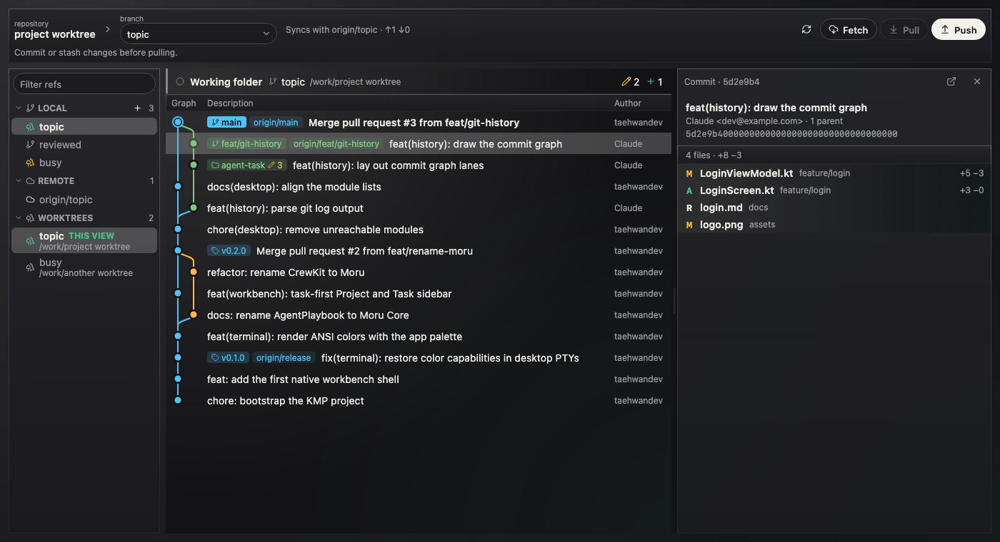
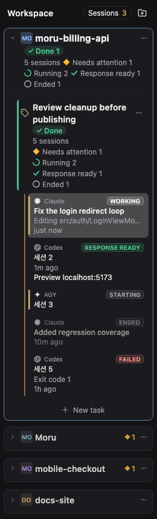
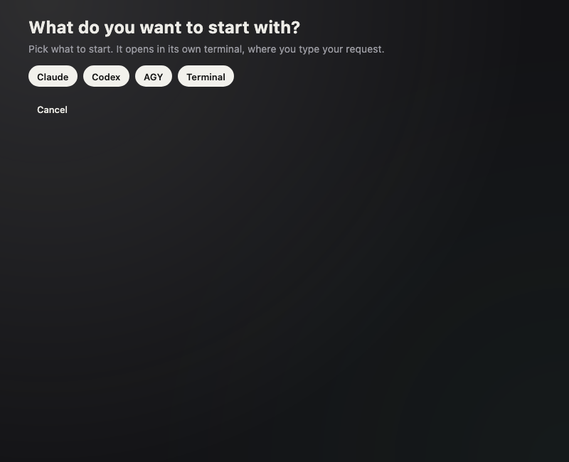

# Moru Community Edition

[English](README.md) · [한국어](README.ko.md) · [简体中文](README.zh-CN.md) · **日本語**

コーディングエージェント向けの、タスク中心のデスクトップワークベンチです。Kotlin Multiplatform と Compose Multiplatform で書かれています。
Project ごとに複数の Task があり、各 Task は実際のターミナル（疑似コンソールではなく本物の PTY）でエージェントを実行します。
隣の Result ビューでは、変更されたコードと Git 履歴を確認できます。

このリポジトリは、以前の Moru アプリのオープンソース IDE コアです。**メンテナンスモード**のため、
バグ修正は歓迎しますが、新しい製品機能の予定はありません。このリポジトリには IDE コアのみが含まれます。

## スクリーンショット

| Git: 履歴グラフ、ブランチ、コミットのファイル | Project と Task ごとにまとめたセッション | Task を始める |
| --- | --- | --- |
|  |  |  |

キャプチャはアプリ自身のスクリーンショットテストのもので、サンプルデータを使っています。

## 含まれるもの

- 永続化されたカタログを持つ Project と Task。
- [pty4j](https://github.com/JetBrains/pty4j) と [JediTerm](https://github.com/JetBrains/jediterm) による実際のターミナル。
  ウィンドウを閉じても生き続ける分離されたターミナルホストを含みます。
- どのセッションが作業中か、待機中か、完了したかを示すエージェントセッション一覧。
- Task の変更ファイルとコードを表示する Result ペイン、履歴・diff・ブランチを扱う Git 画面。
- エージェントがあなたを必要とするときの通知インボックスとデスクトップ通知。
- 設定、ナレッジソース画面、英語と韓国語のテキスト。

モジュール構成と `architecture-test` が強制するルールは [ARCHITECTURE.md](ARCHITECTURE.md) を参照してください。

## ビルドと実行

JDK 21 と macOS（主要プラットフォーム）が必要です。

```sh
./gradlew :app-desktop:run          # 開発モードでアプリを実行
./gradlew desktopTest               # すべてのモジュールのテストを実行
./gradlew :app-desktop:packageDmg   # macOS 用 DMG をビルド
```

`MORU_SIGN_IDENTITY` に Developer ID 証明書の名前を指定しない限り、リリース署名は無効です。
アプリのデータは `~/Library/Application Support/Moru Community` と `~/.moru-community` に保存され、
他の Moru のデータには触れません。

## ライセンス

Apache License 2.0 です。[LICENSE](LICENSE) と [NOTICE](NOTICE) を参照してください。サードパーティのライブラリとそのライセンスは
[THIRD_PARTY.md](THIRD_PARTY.md) に記載されています。
