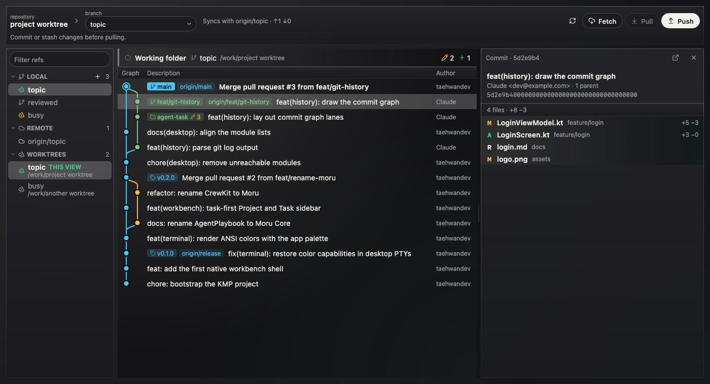
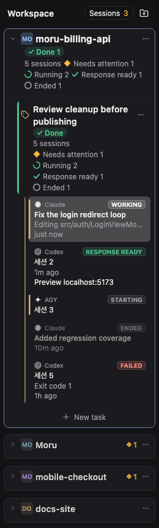
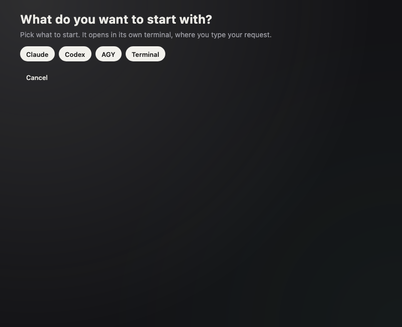

# Moru Community Edition

[English](README.md) · **한국어** · [简体中文](README.zh-CN.md) · [日本語](README.ja.md)

코딩 에이전트를 위한 작업 중심 데스크톱 워크벤치입니다. Kotlin Multiplatform과 Compose Multiplatform으로 만들었습니다.
Project마다 여러 Task가 있고, 각 Task는 실제 터미널(의사 콘솔이 아닌 진짜 PTY)에서 에이전트를 실행하며,
옆의 Result 화면에서 변경된 코드와 Git 이력을 볼 수 있습니다.

이 저장소는 이전 Moru 앱의 오픈소스 IDE 코어입니다. **유지보수 모드**여서
버그 수정은 환영하지만 새 제품 기능은 계획하지 않습니다. 이 저장소는 IDE 코어만 담고 있습니다.

## 스크린샷

| Git: 이력 그래프, 브랜치, 커밋의 파일 | Project와 Task별로 묶인 세션 | Task 시작 |
| --- | --- | --- |
|  |  |  |

캡처는 앱의 스크린샷 테스트에서 가져온 것이며 샘플 데이터를 사용합니다.

## 들어 있는 것

- 영구 저장되는 카탈로그를 가진 Project와 Task.
- [pty4j](https://github.com/JetBrains/pty4j)와 [JediTerm](https://github.com/JetBrains/jediterm)으로 구현한 실제 터미널.
  창이 닫혀도 살아 있는 분리된 터미널 호스트를 포함합니다.
- 어떤 세션이 작업 중인지, 기다리는지, 끝났는지 보여 주는 에이전트 세션 목록.
- Task의 변경 파일과 코드를 보여 주는 Result 창, 이력·diff·브랜치를 보는 Git 화면.
- 에이전트가 사용자를 필요로 할 때의 알림함과 데스크톱 알림.
- 설정, 지식 소스 화면, 영어와 한국어 텍스트.

모듈 구성과 `architecture-test`가 강제하는 규칙은 [ARCHITECTURE.md](ARCHITECTURE.md)를 보세요.

## 빌드와 실행

JDK 21과 macOS(주 플랫폼)가 필요합니다.

```sh
./gradlew :app-desktop:run          # 개발 모드로 앱 실행
./gradlew desktopTest               # 모든 모듈의 테스트 실행
./gradlew :app-desktop:packageDmg   # macOS DMG 빌드
```

`MORU_SIGN_IDENTITY`에 Developer ID 인증서 이름을 지정하지 않으면 릴리스 서명은 꺼져 있습니다.
앱 데이터는 `~/Library/Application Support/Moru Community`와 `~/.moru-community`에 저장되며,
다른 Moru 데이터는 건드리지 않습니다.

## 라이선스

Apache License 2.0입니다. [LICENSE](LICENSE)와 [NOTICE](NOTICE)를 보세요. 서드파티 라이브러리와 그 라이선스는
[THIRD_PARTY.md](THIRD_PARTY.md)에 있습니다.
