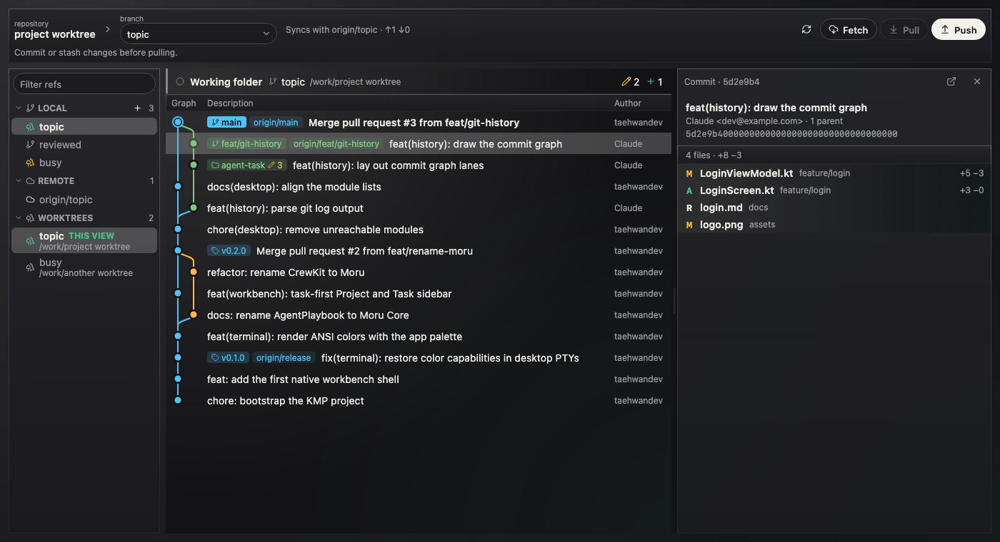
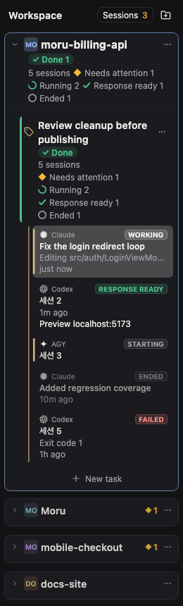
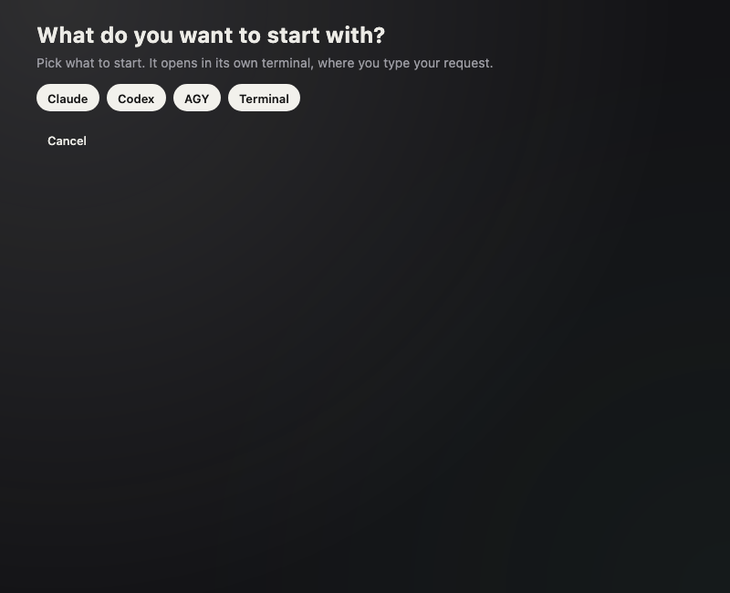

# Moru Community Edition

[English](README.md) · [한국어](README.ko.md) · **简体中文** · [日本語](README.ja.md)

面向编码智能体（coding agent）的任务优先桌面工作台，使用 Kotlin Multiplatform 与 Compose Multiplatform 编写。
每个 Project 包含多个 Task；每个 Task 在真实终端（真正的 PTY，而不是伪控制台）中运行其智能体，
旁边的 Result 视图显示变更的代码和 Git 历史。

本仓库是早期 Moru 应用的开源 IDE 核心，处于**维护模式**：
欢迎提交错误修复，但不计划新增产品功能。本仓库只包含 IDE 核心。

## 截图

| Git：历史图、引用和提交的文件 | 按 Project 与 Task 分组的会话 | 启动 Task |
| --- | --- | --- |
|  |  |  |

截图来自应用自带的截图测试，使用的是示例数据。

## 包含的内容

- 带持久化目录的 Project 与 Task。
- 基于 [pty4j](https://github.com/JetBrains/pty4j) 和 [JediTerm](https://github.com/JetBrains/jediterm) 的真实终端，
  包括在窗口关闭后仍然存活的独立终端宿主。
- 显示各会话正在工作、等待还是已完成的智能体会话列表。
- 显示 Task 变更文件与代码的 Result 面板，以及包含历史、diff 和分支的 Git 界面。
- 智能体需要你时的通知收件箱和桌面通知。
- 设置、知识来源界面，以及英文和韩文文本。

模块结构以及 `architecture-test` 强制执行的规则见 [ARCHITECTURE.md](ARCHITECTURE.md)。

## 构建与运行

需要 JDK 21 和 macOS（主要平台）。

```sh
./gradlew :app-desktop:run          # 以开发模式运行应用
./gradlew desktopTest               # 运行所有模块的测试
./gradlew :app-desktop:packageDmg   # 构建 macOS DMG
```

除非 `MORU_SIGN_IDENTITY` 指定了 Developer ID 证书，否则发布签名处于关闭状态。
应用数据保存在 `~/Library/Application Support/Moru Community` 和 `~/.moru-community`，
不会触碰其他 Moru 数据。

## 许可证

Apache License 2.0，见 [LICENSE](LICENSE) 和 [NOTICE](NOTICE)。第三方库及其许可证列在
[THIRD_PARTY.md](THIRD_PARTY.md) 中。
